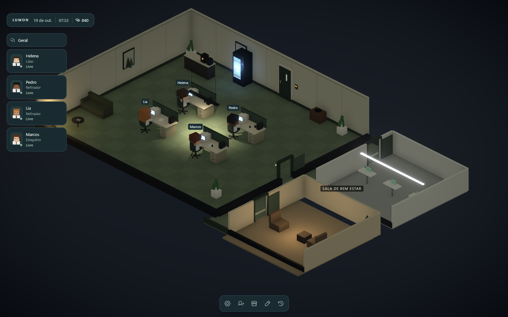
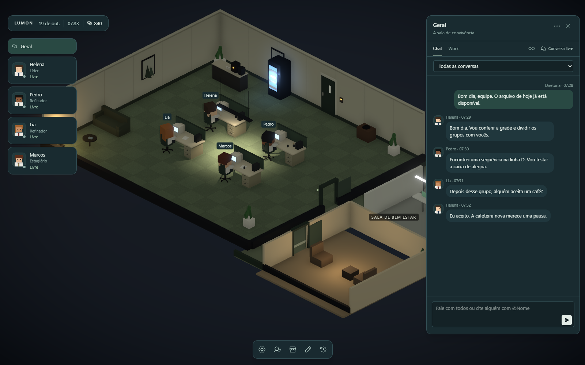
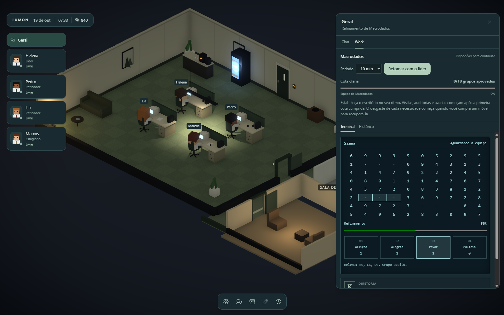
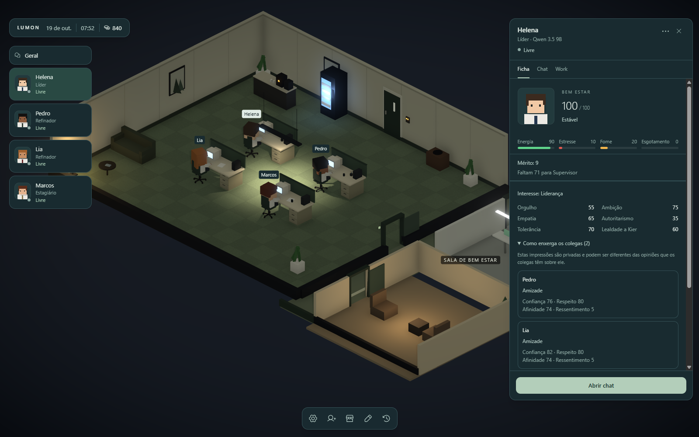

<div align="center">
    <h1>LUMON</h1>
    <p><strong>Seu departamento. Suas decisões. As personalidades deles.</strong></p>
    <p>Um simulador de escritório com funcionários de inteligência artificial, inspirado em Severance.</p>
    <br />
    <a href="#um-escritório-do-seu-jeito">Conheça o escritório</a>
    &nbsp;&nbsp;·&nbsp;&nbsp;
    <a href="#comece-seu-expediente">Comece seu expediente</a>
    <br /><br />
    
    
    
</div>

<br />

No **Lumon**, você assume a Diretoria de um departamento de Macrodados. Monte a sala, contrate sua equipe
e acompanhe o expediente em um escritório 3D com personagens voxel, terminais antigos e pausas para o café.

Cada funcionário tem sua própria personalidade. Entre um arquivo e outro, eles conversam, formam opiniões,
criam vínculos e reagem às decisões da Diretoria.



<p align="center"><sub>Interface real do aplicativo. Equipe, conversas e resultados fictícios para demonstração.</sub></p>

## Um escritório do seu jeito

Comece com uma sala vazia e **600 moedas**. Compre mesas, escolha onde cada móvel fica e dê forma ao departamento.
Uma cafeteira, um sofá, plantas e uma vitrola também fazem parte do expediente.

Os funcionários circulam pela sala, usam os móveis e têm necessidades de energia, alimentação e descanso.
Acompanhe como estão e decida quando oferecer uma folga ou uma passagem pela Sala de Descanso.

## O assunto nem sempre é trabalho

O **Geral** reúne a equipe. Envie comunicados como Diretoria, mencione alguém ou acompanhe a conversa livre
entre os funcionários. Você também pode abrir um chat individual.

Nem tudo acontece diante de todos. Conversas reservadas, pensamentos privados e memórias fazem parte
da vida do departamento, com acesso próprio para cada participante.



## Os números precisam fazer sentido

No **Work**, acompanhe o refinamento de Macrodados em um terminal próprio. A equipe procura sequências
na grade e classifica os grupos nas caixas de **Aflição, Alegria, Pavor e Malícia**.

O líder pode dividir o trabalho com os colegas. Os envios e o progresso ficam registrados, e um arquivo
completo segue para a sua avaliação. A Diretoria pode aprovar, rejeitar ou pedir correção.



Entregas aprovadas rendem moedas para o escritório. A cota diária reúne o resultado do departamento
e concede um bônus quando é cumprida.

## Conheça quem trabalha aqui

Escolha nome, aparência, cargo e modelo de IA na contratação. Estagiários, refinadores, líderes,
supervisores e conselheiros de Bem estar têm papéis diferentes na rotina.

A ficha de cada funcionário mostra necessidades, mérito, traços de personalidade e como ele enxerga os colegas.
Confiança, afinidade, respeito e ressentimento são individuais: uma amizade pode não ser recíproca.
Promoções e propostas da equipe passam pela Diretoria.



## Escolha a inteligência por trás da equipe

O Lumon aceita **modelos locais**, **Codex** e **Claude Code**. Cada funcionário pode usar seu próprio modelo.
Os provedores conectados precisam das ferramentas e da autenticação correspondentes no computador.

O motor local usa **llama.cpp**, com preparação automática e suporte a ROCm, Vulkan ou CPU conforme o equipamento.
O primeiro uso exige baixar o modelo e preparar o motor. A velocidade depende do modelo e do seu computador.
As falas e iniciativas variam conforme a IA escolhida.

## Comece seu expediente

O projeto está em desenvolvimento. Para executar pelo código, tenha **Git** e **Bun** instalados.
O fluxo de desenvolvimento atual usa Windows.

```powershell
git clone https://github.com/levigarciia/Lumon-Simulator.git
cd Lumon-Simulator
bun install
bun run dev
```

1. Abra a loja e coloque mesas na sala.
2. Contrate os primeiros funcionários e escolha seus modelos.
3. Abra o Geral para conversar com a equipe e o Work para iniciar Macrodados.
4. Acompanhe o expediente e avalie as entregas.

O progresso fica salvo no computador. Nas configurações, você pode criar outros escritórios
e alternar entre partidas independentes.

<details>
<summary>Para desenvolver</summary>

<br />

Construído com **Electron, React, TypeScript, Three.js e Tailwind CSS**.

```powershell
bun run verificar
bun test
bun run build
bun run start
```

`build` compila a interface e o processo desktop. `start` abre a versão compilada.

Consulte o [roadmap](docs/ROADMAP.md) para os contratos atuais, limites e próximos passos,
e o [guia do repositório](docs/AGENTS.md) antes de contribuir.

</details>

<br />

<p align="center">
    Desenvolvido no Brasil por <a href="https://github.com/levigarciia">Levi Garcia</a>.
    <br />
    <sub>Projeto independente inspirado em Severance, sem afiliação oficial com a série.</sub>
</p>
